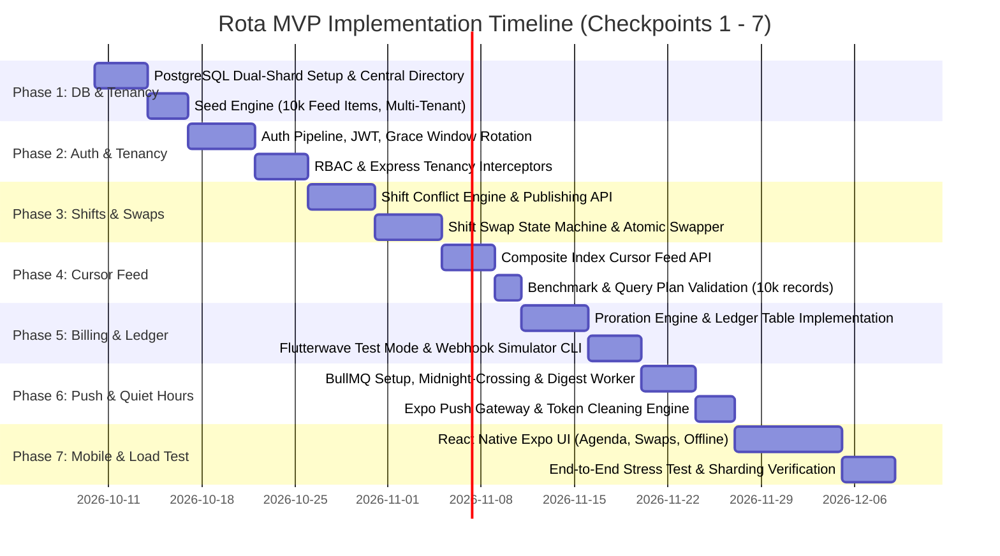

# Product Requirements Document (PRD)
## Project Name: Rota
**Mobile-First Shift Scheduling & Workforce Coordination Platform**

---

| Document Metadata | Value |
| :--- | :--- |
| **Status** | Audited, Hardened & Build-Ready |
| **Version** | 1.1.0 (Post-Audit Consensus) |
| **Target Platforms** | Android (EAS Managed Build), Node.js (Express/TypeScript REST API) |
| **Architectural Target** | Multi-Tenant Sharded PostgreSQL (`relationMode = "prisma"`), BullMQ / Redis |
| **Primary Authors** | Senior Product Strategist & Principal Software Architect |

---

## 1. Product Summary & Core Value Proposition

### 1.1 Executive Summary
**Rota** is a resilient, mobile-first shift scheduling and workforce operational platform designed specifically for deskless shift-based workforces in small-to-medium businesses (independent restaurants, urgent care clinics, retail boutiques, and specialty service providers). 

Traditional enterprise workforce management suites (e.g., UKG, Deputy, 7shifts) suffer from severe feature bloat, high cost per seat, and desktop-first UX paradigms that disconnect frontline workers from real-time operational reality. Conversely, unmanaged messaging channels (e.g., WhatsApp groups, SMS threads, paper rotas) trigger chaotic schedule slippage, compliance failures, missed shifts, and manual payroll calculation errors.

Rota delivers an ultra-streamlined, deterministic operating model:
- **Business Owners/Managers** configure operational rosters, enforce schedule budgets, publish conflict-free shifts, and maintain absolute oversight over labor rosters and billing.
- **Frontline Staff** receive instantaneous roster updates, view upcoming obligations offline, request peer-to-peer shift swaps with automated managerial approval workflows, and experience zero push-notification fatigue during off-hours.
- **SaaS Architecture** utilizes transparent, seat-based tiered billing with strict server-enforced seat limits, server-side proration calculations, append-only financial ledger tracking, and multi-tenant isolation scaled across a simulated sharded PostgreSQL topology.

### 1.2 Formal Seat Definition & Concurrency Governance
To prevent billing leakage and race conditions:
1. **Billable Seat Invariant**: A seat is legally consumed if:
   $$\text{Consumed Seats} = \text{COUNT}(\text{TeamMembership WHERE isActive = true}) + \text{COUNT}(\text{TeamInvitation WHERE acceptedAt IS NULL AND expiresAt} > \text{NOW}())$$
2. **Invitation & Join Concurrency Control**: When an invitation is accepted or a new member is invited, the transaction must acquire a Redis distributed lock (`redlock:team_seats:{teamId}`) or execute an explicit row-level lock:
   ```sql
   SELECT total_seats FROM subscriptions WHERE team_id = $1 FOR UPDATE;
   ```
   If $\text{Consumed Seats} \ge \text{Subscription.totalSeats}$, the server strictly aborts the operation with HTTP `402 Payment Required` (`SEAT_LIMIT_REACHED`).

### 1.3 Core Value Proposition Matrix

| Stakeholder | Friction Points Addressed | Concrete Product Value |
| :--- | :--- | :--- |
| **Business Owner** | Unpredictable SaaS seat costs; labor budget leakage; unverified verbal shift swaps. | Predictable seat-based pricing; append-only billing ledger; strict managerial veto gates on all shift handoffs; real-time visibility into active roster costs. |
| **Store / Clinic Manager** | Endless schedule renegotiations; double-booking errors; high friction in communicating schedule releases. | Conflict-free shift publishing; 1-click swap authorization engine; instant broadcast of available/open shifts; deterministic activity feeds. |
| **Frontline Worker (Staff)** | Last-minute unannounced roster changes; invasive late-night notifications; lost shifts due to poor connectivity. | Native mobile-first interface; persistent offline view of published shifts; peer swap requests with stateful tracking; time-zone-aware notification quiet hours. |

---

## 2. User Personas & Role-Based Permissions

### 2.1 Persona Specifications

#### Persona A: Elena – The Independent Restaurant Owner (Role: `OWNER`)
- **Profile**: Owns a 28-seat bistro and bar with 22 hourly staff (cooks, runners, bartenders, servers).
- **Behaviors & Needs**: Accesses Rota primarily on a tablet or mobile device. Cares about fixed operating margins, ensuring staff count does not exceed paid subscription seats, and preventing accidental double shifts that incur overtime liabilities. Needs strict controls so managers cannot view financial billing or cancel subscriptions.

#### Persona B: Marcus – The Urgent Care Clinic Lead (Role: `MANAGER`)
- **Profile**: Operations manager responsible for scheduling 14 nurses and medical assistants across 3 weekly rotating rosters.
- **Behaviors & Needs**: Works fast on mobile while moving across clinic floors. Creates drafts, checks shift overlaps, broadcasts published rosters, reviews and approves/denies nurse swap requests, and oversees daily shift check-ins. Has zero access to subscription billing credentials.

#### Persona C: Priya – Frontline Barista / Triage Nurse (Role: `STAFF`)
- **Profile**: Hourly employee working variable 6- to 8-hour shifts across multiple days.
- **Behaviors & Needs**: Operates exclusively via Android smartphone. Relies on Rota for notifications when a roster is published, checks scheduled start times during poor network reception in store basements, and triggers swap requests when sudden personal conflicts occur without needing to text managers personally.

### 2.2 Role-Based Access Control (RBAC) Permission Matrix & Cache Invalidation

Rota enforces server-evaluated RBAC. Client-side role claims are never trusted. 
- Permissions are cached in Redis: `team:{teamId}:user:{userId}:role` (TTL: 60 seconds).
- Any role change or deactivation synchronously deletes this Redis key and increments `User.tokenVersion`, causing immediate rejection of stale JWT claims.

| Domain Action | Resource Endpoint / Operation | OWNER | MANAGER | STAFF |
| :--- | :--- | :---: | :---: | :---: |
| **Team Management** | Update Team Name, Timezone, Policies | **✓** | ✗ | ✗ |
| | Invite New Member (`STAFF` or `MANAGER`) | **✓** | **✓** (Staff only) | ✗ |
| | Revoke Membership / Deactivate Member | **✓** | ✗ | ✗ |
| | Transfer Team Ownership | **✓** | ✗ | ✗ |
| **Subscription & Billing** | View Current Plan, Invoices, Ledger | **✓** | ✗ | ✗ |
| | Upgrade Plan, Buy Additional Seats | **✓** | ✗ | ✗ |
| | Schedule Plan Downgrade (Roster cap verified) | **✓** | ✗ | ✗ |
| | Manage Flutterwave Payment Methods | **✓** | ✗ | ✗ |
| **Shift Management** | Create Shift (Draft or Direct) | **✓** | **✓** | ✗ |
| | Edit Shift (Time, Role, Notes) | **✓** | **✓** | ✗ |
| | Cancel Shift (Soft-cancel, non-destructive) | **✓** | **✓** | ✗ |
| | Publish Shift Roster (Bulk or Single) | **✓** | **✓** | ✗ |
| | View Team Published Roster | **✓** | **✓** | **✓** |
| | View Draft / Unpublished Shifts | **✓** | **✓** | ✗ |
| **Shift Swap Lifecycle** | Initiate Swap Request (Own Shift) | **✓** | **✓** | **✓** |
| | Post Open Shift to Swap Pool | **✓** | **✓** | **✓** |
| | Peer-Accept / Decline Swap Offer | **✓** | **✓** | **✓** (Target staff) |
| | Claim Open Pool Shift | **✓** | **✓** | **✓** |
| | Managerial Approval / Denial of Swap | **✓** | **✓** | ✗ |
| | Cancel Outgoing Swap Request | **✓** | **✓** | **✓** (Initiator only) |
| **Activity Feed & Audit** | View Team Activity Feed | **✓** | **✓** | **✓** |
| | View Financial Audit Ledger | **✓** | ✗ | ✗ |
| **Profile & Device** | Register Device Push Token | **✓** | **✓** | **✓** |
| | Update Quiet Hours & Profile Timezone | **✓** | **✓** | **✓** |
| | Invalidate All Active Sessions | **✓** | **✓** | **✓** |

---

## 3. Goals and Non-Goals (MVP Boundaries)

### 3.1 Goals
- **G1**: Provide instantaneous, conflict-free shift scheduling for teams up to 100 members with zero UI friction on Android mobile screens.
- **G2**: Deliver complete end-to-end multi-tenant isolation with zero data cross-contamination.
- **G3**: Implement an append-only directional financial ledger and proration computation engine that guarantees zero floating-point calculation errors by enforcing strict integer-cent math.
- **G4**: Ensure predictable mobile activity feed scrolling through deterministic cursor-based pagination backed by composite indexed PostgreSQL queries supporting datasets exceeding 10,000+ items.
- **G5**: Respect worker rest periods via queue-backed push notifications that consolidate off-hours alerts and defer delivery until local quiet hours expire.
- **G6**: Support full offline read resilience for published shifts on the mobile app, automatically resyncing upon network re-establishment with expiration guards on queued offline mutations.
- **G7**: Simulate high-throughput multi-tenant horizontal scalability through a deterministic 2-database sharding router based on team identifier hashing, using `relationMode = "prisma"` and a Central Directory model for global authentication.

### 3.2 Non-Goals (Strict Out-of-Scope Boundaries for MVP)
- **NG1: Complex Biometric Geofencing or GPS Clock-In**: Rota is a scheduling and swap platform, not a biometric time-clock or payroll-punch tracker.
- **NG2: Direct In-App Chat or Rich Media Messaging**: Rota will not build a full WhatsApp/Slack clone. Communications are strictly event-driven (shift notifications, swap request comments, automated system feeds).
- **NG3: Multi-Currency Dynamic FX Conversion**: All subscription transactions are denominated in minor units of USD (cents) or NGN (kobo). Dynamic cross-currency real-time Forex is out of scope.
- **NG4: Drag-and-Drop Desktop Gantt Chart**: The primary interface is an ergonomic mobile list/agenda view. Complex desktop multi-week drag-and-drop matrices will not be built for MVP.
- **NG5: Automated AI Roster Optimization**: Rota provides human-directed scheduling with server-side conflict detection. Automated algorithmic AI schedule generation is deferred to v2.

---

## 4. Functional Requirements

### R1: Authentication, Tenancy & Token Lifecycle
- **R1.1 Sign-Up & Team Provisioning**:
  - Endpoint `POST /api/v1/auth/register`: Accepts owner name, email, password, team name, and timezone.
  - Provisions `User`, `Team`, and links them via `TeamMembership` (`role = OWNER`) in the Central Directory Database (`DB_SHARD_0`).
  - Provisions a default Starter subscription in the database within a single database transaction.
- **R1.2 Token Architecture**:
  - **Access Token**: Short-lived JWT (15-minute lifespan). Payload: `{ sub: userId, teamId: currentTeamId, role: currentRole, tokenVersion: Int, jti: uuid }`. Signed with HMAC-SHA256 (`JWT_SECRET`).
  - **Refresh Token**: Opaque, cryptographically secure 64-byte random hex string. Stored hashed (SHA-256) in the database with family tracking (`familyId`), rotation state, and absolute expiration (30 days).
  - Mobile storage: Refresh and access tokens stored strictly using `expo-secure-store`.
- **R1.3 Token Rotation with 15-Second Grace Window**:
  - Endpoint `POST /api/v1/auth/refresh`: Accepts `{ refreshToken }`.
  - When $R_1$ is rotated to $R_2$, store in Redis: `SET token:grace:{hash(R1)} {hash(R2)} EX 15`.
  - If $R_1$ is presented within 15 seconds (network retry/parallel app resume calls): The server returns the already-issued $R_2$ and new access token without minting a third token or revoking the family.
  - If a revoked token is presented *outside* the 15-second grace window: Immediate security trigger invalidates the entire `familyId`, deletes all user Redis sessions, and returns HTTP `401 Unauthorized` (`TOKEN_REUSE_DETECTED`).
- **R1.4 Global Session Invalidation**:
  - Endpoint `POST /api/v1/auth/revoke-all`: Increments the user's `tokenVersion` in the database and clears all Redis session hashes. Any access token carrying a stale `tokenVersion` is rejected at the authentication middleware.
- **R1.5 Team Invitations**:
  - Endpoint `POST /api/v1/teams/:teamId/invitations`: Requires `OWNER` or `MANAGER`. Cannot invite `OWNER` role.
  - Evaluates Billable Seat Invariant. If $\text{Consumed Seats} \ge \text{Subscription.totalSeats}$, rejects with HTTP `402 Payment Required` (`SEAT_LIMIT_REACHED`).
  - Sends invitation token (cryptographically signed HMAC token with 72-hour TTL).
  - Endpoint `POST /api/v1/teams/join`: Accepts `{ token, password, name }`. Verifies seat capacity under lock, creates `TeamMembership`, and marks invitation accepted.

### R2: Shift Scheduling & Swap Requests
- **R2.1 Shift Creation & Validation**:
  - Endpoint `POST /api/v1/teams/:teamId/shifts`: Requires `OWNER` or `MANAGER`.
  - Inputs validated against Zod schema: `userId` (optional), `startTime`, `endTime`, `roleTitle`, `notes`, `status` (`DRAFT` | `PUBLISHED`).
  - **Temporal Validation**: `endTime` must be strictly greater than `startTime`, with max duration capped at 24 hours.
  - **Conflict Detection Engine**: Server executes an indexed check to prevent overlapping shifts for the same worker:
    $$\text{Overlap Condition: } (\text{start}_{\text{new}} < \text{end}_{\text{existing}}) \land (\text{end}_{\text{new}} > \text{start}_{\text{existing}})$$
    If an overlap is detected for target `userId`, request is rejected with HTTP `409 Conflict` (`STAFF_ALREADY_SCHEDULED`).
- **R2.2 Shift Publishing Lifecycle**:
  - Shift states are controlled strictly by `status` enum: `DRAFT`, `PUBLISHED`, `CANCELLED`, `COMPLETED`. (No redundant `isPublished` boolean).
  - Endpoint `POST /api/v1/teams/:teamId/shifts/publish`: Accepts `{ shiftIds: string[] }` or `{ startDate, endDate }`.
  - Atomically marks matching shifts as `status = PUBLISHED`.
  - Emits a BullMQ batch job `shift-published-event` to notify assigned staff.
- **R2.3 Shift Swap Request Lifecycle & Conflict Locking**:
  - **Swap Status Machine**:
    $$\text{OPEN\_FOR\_CLAIM} \mid \text{PENDING\_PEER\_APPROVAL} \longrightarrow \text{PENDING\_MANAGER\_APPROVAL} \longrightarrow \text{APPROVED}$$
    $$\text{Terminal States: } \text{REJECTED} \mid \text{CANCELLED}$$
  - **Single Active Swap Invariant**: A shift cannot be placed into a swap request if it is already referenced as `sourceShiftId` in any swap with status `OPEN_FOR_CLAIM`, `PENDING_PEER_APPROVAL`, or `PENDING_MANAGER_APPROVAL`.
  - Step 1: Staff creates swap `POST /api/v1/teams/:teamId/swaps`. If `targetUserId` is null, status is `OPEN_FOR_CLAIM`. If target specified, status is `PENDING_PEER_APPROVAL`.
  - Step 2: Peer accepts (`PENDING_PEER_APPROVAL -> PENDING_MANAGER_APPROVAL`) or team member claims open drop (`OPEN_FOR_CLAIM -> PENDING_MANAGER_APPROVAL`).
  - Step 3: Manager evaluates `POST /api/v1/teams/:teamId/swaps/:swapId/review`: Accepts `{ action: "APPROVE" | "DENY", reason?: string }`.
  - **Atomic Finalization on Approval**:
    Under a single serializable transaction:
    1. Verify neither shift has started and both are still in `PUBLISHED` status.
    2. Atomically swap `assignedToId` on the `Shift` records.
    3. Update `ShiftSwapRequest.status = APPROVED`.
    4. Insert dual records into `ActivityFeedItem`.
    5. Trigger notification jobs for both staff members.

### R3: Cursor-Paginated Activity Feed
- **R3.1 Performance Objective**:
  - Sustains $< 20\text{ms}$ query latency on tables with $> 10,000$ seeded records per tenant.
- **R3.2 Pagination Protocol**:
  - Endpoint `GET /api/v1/teams/:teamId/feed?cursor=...&limit=25`:
  - Cursor is a base64-encoded JSON payload: `base64(JSON.stringify({ createdAt: ISOString, id: String }))`.
  - **Prisma Relational Query Implementation**:
    Because relational multi-column cursor requires exact unique composite indexes, the repository layer executes the deterministic composite `where` filter:
    ```typescript
    const items = await prisma.activityFeedItem.findMany({
      where: {
        teamId,
        ...(cursor ? {
          OR: [
            { createdAt: { lt: cursor.createdAt } },
            { createdAt: cursor.createdAt, id: { lt: cursor.id } }
          ]
        } : {})
      },
      orderBy: [
        { createdAt: 'desc' },
        { id: 'desc' }
      ],
      take: limit + 1
    });
    ```
  - If `items.length > limit`, pop the extra record and encode its `(createdAt, id)` as `nextCursor`. Otherwise, `nextCursor` is `null`.

### R4: Billing, Proration Engine & Ledger
- **R4.1 Pricing Tiers & Seat Policy**:
  - Strictly minor units (integers) in database.

| Plan Name | Base Monthly Price (cents) | Base Seats Included | Incremental Cost / Seat / Month (cents) | Max Seat Cap |
| :--- | :--- | :--- | :--- | :--- |
| **Starter** | \$20.00 (`2000`) | 5 | N/A (Cannot add extra) | 5 |
| **Team** | \$50.00 (`5000`) | 15 | \$3.00 (`300`) | 35 |
| **Business** | \$120.00 (`12000`) | 40 | \$2.00 (`200`) | Unlimited |

- **R4.2 Server-Side Proration Math**:
  - When an Owner increases seats or upgrades plans midway through an active billing cycle:
    Let:
    - $D_{\text{total}} = T_{\text{end}} - T_{\text{start}}$ (total duration in seconds).
    - $D_{\text{remaining}} = T_{\text{end}} - T_{\text{now}}$ (remaining seconds in cycle).
  - **Seat Addition Proration Formula**:
    $$\text{Prorated Charge (cents)} = \left\lfloor \frac{N_{\text{new}} \times U \times D_{\text{remaining}}}{D_{\text{total}}} \right\rfloor$$
  - **Plan Upgrade Proration Formula** (e.g., Starter to Team):
    $$\text{Unused Credit} = \left\lfloor \frac{\text{BasePrice}_{\text{old}} \times D_{\text{remaining}}}{D_{\text{total}}} \right\rfloor$$
    $$\text{New Plan Cost} = \left\lfloor \frac{\text{BasePrice}_{\text{new}} \times D_{\text{remaining}}}{D_{\text{total}}} \right\rfloor$$
    $$\text{Immediate Due (cents)} = \max\left(0, \text{New Plan Cost} - \text{Unused Credit}\right)$$
  - Rounding Rule: Strict integer division using `Math.floor()` in minor units.
- **R4.3 Downgrade & Seat Reduction Policy**:
  - Mid-cycle downgrades or seat reductions **never** issue cash refunds.
  - **Hard Invariant**: A team cannot schedule a downgrade if `activeMemberCount > targetPlanMaxSeats`. API returns HTTP `422 Unprocessable Entity` (`ROSTER_EXCEEDS_TARGET_PLAN_CAP`).
  - Downgrades and seat decreases take effect strictly at `currentPeriodEnd`.
- **R4.4 Directional Financial Ledger**:
  - Table: `subscription_ledgers`. 
  - Every transaction records an immutable entry with `direction: DEBIT | CREDIT`, `amountCents: Int`, and `balanceAfterCents: Int`.
- **R4.5 Flutterwave Synchronous Authorization**:
  - Seat additions and upgrades require synchronous charge authorization via Flutterwave before `Subscription.totalSeats` or `Subscription.plan` is updated in the database.

### R5: Push Notifications & Quiet Hours
- **R5.1 Device Registration**:
  - Endpoint `POST /api/v1/devices/register`: Stores `expoPushToken`, device platform (`ANDROID`), and links to `userId`.
- **R5.2 Timezone-Aware Quiet Hours Evaluation**:
  - Fields in `User`: `timezone` (IANA string, e.g., `"America/New_York"`), `quietHoursEnabled` (boolean), `quietHoursStart` (`"22:00"`), `quietHoursEnd` (`"07:00"`).
  - **Midnight-Spanning Window Formula**:
    Using `date-fns-tz`, parse user's current local time $T_{\text{local}}$ (hours and minutes).
    $$\text{isQuiet} = \begin{cases} 
    T_{\text{local}} \ge T_{\text{start}} \lor T_{\text{local}} < T_{\text{end}} & \text{if } T_{\text{start}} > T_{\text{end}} \text{ (spans midnight, e.g., 22:00 to 07:00)} \\
    T_{\text{local}} \ge T_{\text{start}} \land T_{\text{local}} < T_{\text{end}} & \text{if } T_{\text{start}} < T_{\text{end}} \text{ (daytime window)}
    \end{cases}$$
- **R5.3 Digest Consolidation Architecture**:
  - If `isQuiet = true` and urgency is `NORMAL`:
    1. Append the notification payload to Redis list: `user:{userId}:quiet_digest_queue`.
    2. Check if a BullMQ digest job already exists for this user at `quietHoursEnd`:
       Job ID: `quiet_digest_${userId}_${targetDateString}`.
    3. If not scheduled, calculate delay until `quietHoursEnd` and enqueue the digest job.
    4. Suppress immediate push.
  - At `quietHoursEnd`: The worker wakes up, pops all notifications from `user:{userId}:quiet_digest_queue`, and dispatches a single consolidated summary push:
    *"Rota: You have 4 new schedule updates for this week."*
  - If urgency is `CRITICAL` (e.g., shift cancelled $< 2\text{ hours}$ before start): Bypass quiet hours and dispatch immediately with `priority: HIGH`.

### R6: Settings Sync & Offline View
- **R6.1 Mobile Local Cache Architecture**:
  - Built on React Native SQLite / MMKV with encryption keys stored in `expo-secure-store`.
  - Caches published shifts for $[\text{today} - 14\text{ days}, \text{today} + 60\text{ days}]$.
  - If a user's session token is revoked and cannot be refreshed after 7 days, purge the local shift cache.
- **R6.2 Offline Mutation Queue & Expiration Guard**:
  - Client queue records pending mutations with `clientMutationId` and `clientExpiresAt`:
    $$\text{clientExpiresAt} = \min(\text{createdAt} + 2\text{ hours}, \text{shift.startTime} - 1\text{ hour})$$
  - When network reconnects, any mutation where $\text{NOW}() > \text{clientExpiresAt}$ is discarded locally with an alert: *"Shift change expired before it could be synced."*

---

## 5. Backend System Architecture & Data Flow

```
+-------------------------------------------------------------------------------+
|                       Mobile Client (React Native / Expo)                    |
+-------------------------------------------------------------------------------+
                                      |
                                      | HTTPS (Bearer JWT / Refresh Token)
                                      v
+-------------------------------------------------------------------------------+
|                      Express.js Gateway / Middleware Pipeline                 |
|  - RateLimiter (Redis sliding-window)                                         |
|  - AuthMiddleware (Central Directory lookup on DB_SHARD_0 + Redis session)     |
|  - TenantContextMiddleware (extracts team_id, validates membership & role)    |
|  - IdempotencyMiddleware (Redis atomic lock with length-safe SHA-256 checks)  |
+-------------------------------------------------------------------------------+
                                      |
                                      v
+-------------------------------------------------------------------------------+
|                    Tenant Router & 2-DB Sharding Dispatcher                   |
|                   shardIndex = CRC32(teamId) % 2                              |
|                   relationMode = "prisma" (App-level referential integrity)   |
+-------------------------------------------------------------------------------+
                 /                                             \
                / (shardIndex == 0)                             \ (shardIndex == 1)
               v                                                 v
+-----------------------------+                   +-----------------------------+
|    Prisma Client: Shard 0   |                   |    Prisma Client: Shard 1   |
| (PgBouncer: ?pgbouncer=true)|                   | (PgBouncer: ?pgbouncer=true)|
+-----------------------------+                   +-----------------------------+
               |                                                 |
               v                                                 v
+-----------------------------+                   +-----------------------------+
|  PostgreSQL: DB_SHARD_0     |                   |  PostgreSQL: DB_SHARD_1     |
|  (Global Auth + Shard 0)    |                   |  (Tenant-Scoped Shard 1)    |
+-----------------------------+                   +-----------------------------+
                               \                                 /
                                \                               /
                                 v                             v
+-------------------------------------------------------------------------------+
|                   Upstash Redis (Cluster / In-Memory State)                  |
|  - BullMQ Queues: 'notification-digest', 'billing-webhooks', 'audit-events'   |
|  - Redlock: team seat updates & shift swap concurrency locks                  |
|  - Token Rotation Grace Cache (`token:grace:{hash(R1)}` EX 15s)              |
+-------------------------------------------------------------------------------+
```

### 5.1 Express Middleware Pipeline Execution Order
1. **`cors` & `helmet`**: HTTP security headers enforcement.
2. **`rateLimiter`**: Keyed by IP or User ID using Redis sliding-window counter (100 req/min standard, 10 req/min auth).
3. **`authMiddleware`**: Decodes JWT, validates signature, checks expiration, verifies `tokenVersion` against Redis user cache.
4. **`tenantContextMiddleware`**: 
   - Resolves `teamId` from request path params or JWT.
   - Verifies active `TeamMembership` on `teamId` (cached in Redis for 60s).
   - Attaches `req.tenant = { teamId, role, membershipId }`.
5. **`idempotencyMiddleware`**:
   - For state-mutating requests (`POST`, `PUT`, `PATCH`), inspects `Idempotency-Key`.
   - Acquires atomic Redis lock (`SET lock:idempotency:{teamId}:{key} EX 30 NX`).

### 5.2 2-Database Sharding & Central Directory Architecture
- **Global vs. Sharded Entity Split**:
  - **Central Directory (`DB_SHARD_0`)**: Contains `User`, `RefreshToken`, `Team`, `TeamMembership`. During login, Express queries `DB_SHARD_0` to resolve user credentials and obtain valid `teamId` list without needing a team context beforehand.
  - **Sharded Tenant Domain (`DB_SHARD_0` & `DB_SHARD_1`)**: `Shift`, `ShiftSwapRequest`, `ActivityFeedItem`, `Subscription`, `SubscriptionLedger`.
- **Mathematical Distribution Function**:
  $$\text{shardIndex} = (\text{crc32}(\text{teamId}) \ggg 0) \pmod 2$$
  *(Note: JavaScript bitwise zero-fill right shift `>>> 0` enforces an unsigned 32-bit integer, guaranteeing a positive modulo result of `0` or `1`).*
- **Prisma Connection Pooling**:
  All connection URLs append `?pgbouncer=true&connection_limit=15`. Prisma schema specifies `relationMode = "prisma"` to support horizontal database boundaries cleanly.

---

## 6. Complete Prisma Data Model

```prisma
datasource db {
  provider     = "postgresql"
  url          = env("DATABASE_URL")
  relationMode = "prisma"
}

generator client {
  provider = "prisma-client-js"
}

// ---------------------------------------------------------
// ENUMS
// ---------------------------------------------------------

enum Role {
  OWNER
  MANAGER
  STAFF
}

enum ShiftStatus {
  DRAFT
  PUBLISHED
  CANCELLED
  COMPLETED
}

enum SwapStatus {
  OPEN_FOR_CLAIM
  PENDING_PEER_APPROVAL
  PENDING_MANAGER_APPROVAL
  APPROVED
  REJECTED
  CANCELLED
}

enum SubscriptionPlan {
  STARTER
  TEAM
  BUSINESS
}

enum SubscriptionStatus {
  TRIALING
  ACTIVE
  PAST_DUE
  CANCELLED
  UNPAID
}

enum LedgerEntryType {
  BASE_FEE
  SEAT_ADDITION_PRORATED
  PLAN_UPGRADE_PRORATED
  MONTHLY_RENEWAL
  REFUND
  CREDIT_ADJUSTMENT
}

enum LedgerDirection {
  DEBIT
  CREDIT
}

enum ActivityAction {
  SHIFT_CREATED
  SHIFT_PUBLISHED
  SHIFT_UPDATED
  SHIFT_CANCELLED
  SWAP_REQUESTED
  SWAP_PEER_ACCEPTED
  SWAP_PEER_REJECTED
  SWAP_CLAIMED
  SWAP_MANAGER_APPROVED
  SWAP_MANAGER_DENIED
  MEMBER_INVITED
  MEMBER_JOINED
  MEMBER_REMOVED
  SUBSCRIPTION_UPDATED
}

enum DevicePlatform {
  ANDROID
  IOS
}

// ---------------------------------------------------------
// CORE MULTI-TENANCY & IDENTITY (CENTRAL DIRECTORY)
// ---------------------------------------------------------

model Team {
  id                 String               @id @default(uuid()) @db.Uuid
  name               String               @db.VarChar(100)
  slug               String               @unique @db.VarChar(100)
  timezone           String               @default("UTC") @db.VarChar(50)
  createdAt          DateTime             @default(now()) @map("created_at") @db.Timestamptz(6)
  updatedAt          DateTime             @updatedAt @map("updated_at") @db.Timestamptz(6)

  memberships        TeamMembership[]
  shifts             Shift[]
  swapRequests       ShiftSwapRequest[]
  activityFeed       ActivityFeedItem[]
  subscription       Subscription?
  subscriptionLedger SubscriptionLedger[]
  invitations        TeamInvitation[]

  @@map("teams")
}

model User {
  id                 String             @id @default(uuid()) @db.Uuid
  email              String             @unique @db.VarChar(255)
  passwordHash       String             @map("password_hash") @db.VarChar(255)
  fullName           String             @map("full_name") @db.VarChar(100)
  phoneNumber        String?            @map("phone_number") @db.VarChar(30)
  timezone           String             @default("UTC") @db.VarChar(50)
  quietHoursEnabled  Boolean            @default(true) @map("quiet_hours_enabled")
  quietHoursStart    String             @default("22:00") @map("quiet_hours_start") @db.VarChar(5) // HH:mm
  quietHoursEnd      String             @default("07:00") @map("quiet_hours_end") @db.VarChar(5)   // HH:mm
  tokenVersion       Int                @default(1) @map("token_version")
  createdAt          DateTime           @default(now()) @map("created_at") @db.Timestamptz(6)
  updatedAt          DateTime           @updatedAt @map("updated_at") @db.Timestamptz(6)

  memberships        TeamMembership[]
  assignedShifts     Shift[]            @relation("AssignedStaffShifts")
  createdShifts      Shift[]            @relation("ShiftCreatedBy")
  initiatedSwaps     ShiftSwapRequest[] @relation("SwapInitiator")
  targetSwaps        ShiftSwapRequest[] @relation("SwapTargetStaff")
  reviewedSwaps      ShiftSwapRequest[] @relation("SwapReviewer")
  activityFeedEvents ActivityFeedItem[]
  refreshTokens      RefreshToken[]
  deviceTokens       DevicePushToken[]

  @@map("users")
}

model TeamMembership {
  id         String   @id @default(uuid()) @db.Uuid
  teamId     String   @map("team_id") @db.Uuid
  userId     String   @map("user_id") @db.Uuid
  role       Role     @default(STAFF)
  isActive   Boolean  @default(true) @map("is_active")
  joinedAt   DateTime @default(now()) @map("joined_at") @db.Timestamptz(6)
  updatedAt  DateTime @updatedAt @map("updated_at") @db.Timestamptz(6)

  team       Team     @relation(fields: [teamId], references: [id], onDelete: Cascade)
  user       User     @relation(fields: [userId], references: [id], onDelete: Cascade)

  @@unique([teamId, userId])
  @@index([teamId, role, isActive])
  @@map("team_memberships")
}

model TeamInvitation {
  id         String    @id @default(uuid()) @db.Uuid
  teamId     String    @map("team_id") @db.Uuid
  email      String    @db.VarChar(255)
  role       Role      @default(STAFF)
  tokenHash  String    @unique @map("token_hash") @db.VarChar(255)
  expiresAt  DateTime  @map("expires_at") @db.Timestamptz(6)
  acceptedAt DateTime? @map("accepted_at") @db.Timestamptz(6)
  createdAt  DateTime  @default(now()) @map("created_at") @db.Timestamptz(6)

  team       Team      @relation(fields: [teamId], references: [id], onDelete: Cascade)

  @@index([teamId, email])
  @@map("team_invitations")
}

// ---------------------------------------------------------
// AUTHENTICATION & SECURITY TOKENS
// ---------------------------------------------------------

model RefreshToken {
  id          String   @id @default(uuid()) @db.Uuid
  userId      String   @map("user_id") @db.Uuid
  tokenHash   String   @unique @map("token_hash") @db.VarChar(255)
  familyId    String   @map("family_id") @db.Uuid
  isRevoked   Boolean  @default(false) @map("is_revoked")
  expiresAt   DateTime @map("expires_at") @db.Timestamptz(6)
  createdAt   DateTime @default(now()) @map("created_at") @db.Timestamptz(6)

  user        User     @relation(fields: [userId], references: [id], onDelete: Cascade)

  @@index([userId, familyId])
  @@map("refresh_tokens")
}

model DevicePushToken {
  id          String         @id @default(uuid()) @db.Uuid
  userId      String         @map("user_id") @db.Uuid
  pushToken   String         @unique @map("push_token") @db.VarChar(255)
  platform    DevicePlatform @default(ANDROID)
  createdAt   DateTime       @default(now()) @map("created_at") @db.Timestamptz(6)
  updatedAt   DateTime       @updatedAt @map("updated_at") @db.Timestamptz(6)

  user        User           @relation(fields: [userId], references: [id], onDelete: Cascade)

  @@index([userId])
  @@map("device_push_tokens")
}

model IdempotencyKey {
  id           String   @id @default(uuid()) @db.Uuid
  teamId       String   @map("team_id") @db.Uuid
  key          String   @db.VarChar(255)
  responseCode Int      @map("response_code")
  responseBody Json     @map("response_body")
  createdAt    DateTime @default(now()) @map("created_at") @db.Timestamptz(6)
  expiresAt    DateTime @map("expires_at") @db.Timestamptz(6)

  @@unique([teamId, key])
  @@index([expiresAt])
  @@map("idempotency_keys")
}

// ---------------------------------------------------------
// SHIFTS & SWAP MANAGEMENT (SHARDED)
// ---------------------------------------------------------

model Shift {
  id            String      @id @default(uuid()) @db.Uuid
  teamId        String      @map("team_id") @db.Uuid
  assignedToId  String?     @map("assigned_to_id") @db.Uuid
  createdById   String      @map("created_by_id") @db.Uuid
  roleTitle     String      @map("role_title") @db.VarChar(50)
  startTime     DateTime    @map("start_time") @db.Timestamptz(6)
  endTime       DateTime    @map("end_time") @db.Timestamptz(6)
  status        ShiftStatus @default(DRAFT)
  notes         String?     @db.Text
  createdAt     DateTime    @default(now()) @map("created_at") @db.Timestamptz(6)
  updatedAt     DateTime    @updatedAt @map("updated_at") @db.Timestamptz(6)

  team          Team        @relation(fields: [teamId], references: [id], onDelete: Cascade)
  assignedTo    User?       @relation("AssignedStaffShifts", fields: [assignedToId], references: [id], onDelete: SetNull)
  createdBy     User        @relation("ShiftCreatedBy", fields: [createdById], references: [id], onDelete: Restrict)

  originSwaps   ShiftSwapRequest[] @relation("SourceShift")
  targetSwaps   ShiftSwapRequest[] @relation("TargetShift")

  @@index([teamId, startTime, endTime])
  @@index([teamId, assignedToId, startTime, endTime])
  @@index([teamId, status, startTime])
  @@map("shifts")
}

model ShiftSwapRequest {
  id               String     @id @default(uuid()) @db.Uuid
  teamId           String     @map("team_id") @db.Uuid
  sourceShiftId    String     @map("source_shift_id") @db.Uuid
  targetShiftId    String?    @map("target_shift_id") @db.Uuid
  initiatorUserId  String     @map("initiator_user_id") @db.Uuid
  targetUserId     String?    @map("target_user_id") @db.Uuid
  reviewerUserId   String?    @map("reviewer_user_id") @db.Uuid
  status           SwapStatus @default(PENDING_PEER_APPROVAL)
  rejectionReason  String?    @map("rejection_reason") @db.VarChar(255)
  createdAt        DateTime   @default(now()) @map("created_at") @db.Timestamptz(6)
  updatedAt        DateTime   @updatedAt @map("updated_at") @db.Timestamptz(6)

  team             Team       @relation(fields: [teamId], references: [id], onDelete: Cascade)
  sourceShift      Shift      @relation("SourceShift", fields: [sourceShiftId], references: [id], onDelete: Cascade)
  targetShift      Shift?     @relation("TargetShift", fields: [targetShiftId], references: [id], onDelete: SetNull)
  initiator        User       @relation("SwapInitiator", fields: [initiatorUserId], references: [id], onDelete: Cascade)
  targetStaff      User?      @relation("SwapTargetStaff", fields: [targetUserId], references: [id], onDelete: SetNull)
  reviewer         User?      @relation("SwapReviewer", fields: [reviewerUserId], references: [id], onDelete: SetNull)

  @@index([teamId, status, createdAt])
  @@index([teamId, initiatorUserId])
  @@index([teamId, targetUserId])
  @@map("shift_swap_requests")
}

// ---------------------------------------------------------
// ACTIVITY FEED (HIGH PERFORMANCE COMPOSITE INDEX)
// ---------------------------------------------------------

model ActivityFeedItem {
  id         String         @id @default(uuid()) @db.Uuid
  teamId     String         @map("team_id") @db.Uuid
  actorId    String         @map("actor_id") @db.Uuid
  action     ActivityAction
  entityId   String         @map("entity_id") @db.Uuid
  entityType String         @map("entity_type") @db.VarChar(50)
  metadata   Json           @default("{}")
  createdAt  DateTime       @default(now()) @map("created_at") @db.Timestamptz(6)

  team       Team           @relation(fields: [teamId], references: [id], onDelete: Cascade)
  actor      User           @relation(fields: [actorId], references: [id], onDelete: Cascade)

  @@index([teamId, createdAt(sort: Desc), id(sort: Desc)])
  @@unique([createdAt, id])
  @@map("activity_feed_items")
}

// ---------------------------------------------------------
// BILLING, SEATS & FINANCIAL LEDGER (DIRECTIONAL ACCOUNTING)
// ---------------------------------------------------------

model Subscription {
  id                   String             @id @default(uuid()) @db.Uuid
  teamId               String             @unique @map("team_id") @db.Uuid
  plan                 SubscriptionPlan   @default(STARTER)
  status               SubscriptionStatus @default(TRIALING)
  baseSeats            Int                @default(5) @map("base_seats")
  extraSeats           Int                @default(0) @map("extra_seats")
  totalSeats           Int                @default(5) @map("total_seats")
  basePriceCents       Int                @default(2000) @map("base_price_cents")
  extraSeatPriceCents  Int                @default(0) @map("extra_seat_price_cents")
  currentPeriodStart   DateTime           @map("current_period_start") @db.Timestamptz(6)
  currentPeriodEnd     DateTime           @map("current_period_end") @db.Timestamptz(6)
  flutterwaveSubId     String?            @map("flutterwave_sub_id") @db.VarChar(100)
  flutterwaveCustToken String?            @map("flutterwave_cust_token") @db.VarChar(255)
  cancelledAt          DateTime?          @map("cancelled_at") @db.Timestamptz(6)
  createdAt            DateTime           @default(now()) @map("created_at") @db.Timestamptz(6)
  updatedAt            DateTime           @updatedAt @map("updated_at") @db.Timestamptz(6)

  team                 Team               @relation(fields: [teamId], references: [id], onDelete: Cascade)
  ledgerEntries        SubscriptionLedger[]

  @@index([status, currentPeriodEnd])
  @@map("subscriptions")
}

model SubscriptionLedger {
  id               String          @id @default(uuid()) @db.Uuid
  teamId           String          @map("team_id") @db.Uuid
  subscriptionId   String          @map("subscription_id") @db.Uuid
  entryType        LedgerEntryType @map("entry_type")
  direction        LedgerDirection @default(DEBIT)
  amountCents      Int             @map("amount_cents")
  balanceAfterCents Int            @map("balance_after_cents")
  currency         String          @default("USD") @db.VarChar(3)
  periodStart      DateTime        @map("period_start") @db.Timestamptz(6)
  periodEnd        DateTime        @map("period_end") @db.Timestamptz(6)
  description      String          @db.VarChar(255)
  flutterwaveTxRef String?         @unique @map("flutterwave_tx_ref") @db.VarChar(100)
  idempotencyKey   String?         @unique @map("idempotency_key") @db.VarChar(255)
  createdAt        DateTime        @default(now()) @map("created_at") @db.Timestamptz(6)

  team             Team            @relation(fields: [teamId], references: [id], onDelete: Cascade)
  subscription     Subscription    @relation(fields: [subscriptionId], references: [id], onDelete: Cascade)

  @@index([teamId, createdAt(sort: Desc)])
  @@map("subscription_ledgers")
}
```

---

## 7. Security & Failure Modes

### 7.1 Tenant Leakage Prevention
1. **Route-Level Parameter Validation**: Express route middleware validates that `:teamId` in the path matches authenticated JWT payload `teamId` (or verifies valid user membership).
2. **Prisma Client Extension Interceptor**: All Prisma database operations are wrapped with an automated tenancy filter. Any query executing against a tenant-scoped table (`Shift`, `ShiftSwapRequest`, `ActivityFeedItem`, etc.) is injected with `{ where: { teamId } }`. If executed without `teamId`, the extension aborts the operation.
3. **Database Shard Segmentation**: Teams are physically isolated across distinct database instances based on `CRC32(teamId) % 2`. Data on Shard 1 is physically unreachable from queries dispatched to Shard 0.

### 7.2 Token Rotation with 15-Second Grace Window
```typescript
// Pseudocode for Token Family Verification with Grace Window
const tokenRecord = await prisma.refreshToken.findUnique({ where: { tokenHash } });

if (!tokenRecord || tokenRecord.isRevoked) {
  // Check if within 15s grace window
  const activeReplacement = await redis.get(`token:grace:${tokenHash}`);
  if (activeReplacement) {
    // Return existing active replacement without minting new tokens
    return { tokenHash: activeReplacement, accessToken: issueAccessToken(user) };
  }

  // REUSE DETECTED: Revoke entire family!
  await prisma.refreshToken.updateMany({
    where: { familyId: tokenRecord?.familyId },
    data: { isRevoked: true }
  });
  await redis.del(`session:${tokenRecord?.userId}`);
  throw new SecurityException("TOKEN_REUSE_DETECTED");
}

// Mark consumed, issue child, register grace window
await prisma.refreshToken.update({ where: { id: tokenRecord.id }, data: { isRevoked: true } });
const nextToken = generateSecureToken();
await prisma.refreshToken.create({
  data: { userId, tokenHash: hash(nextToken), familyId: tokenRecord.familyId, expiresAt }
});
await redis.set(`token:grace:${tokenHash}`, hash(nextToken), "EX", 15);
```

### 7.3 Length-Safe Flutterwave Webhook Signature Verification
```typescript
export function verifyFlutterwaveSignature(req: Request, res: Response, next: NextFunction) {
  const receivedHash = req.headers["verif-hash"] as string | undefined;
  const expectedHash = process.env.FLUTTERWAVE_SECRET_HASH || "";

  if (!receivedHash) {
    return res.status(401).json({ error: "MISSING_SIGNATURE" });
  }

  const hashBuffer = Buffer.from(receivedHash);
  const secretBuffer = Buffer.from(expectedHash);

  // Buffer length check avoids crypto.timingSafeEqual exception
  if (hashBuffer.length !== secretBuffer.length || !crypto.timingSafeEqual(hashBuffer, secretBuffer)) {
    return res.status(401).json({ error: "INVALID_SIGNATURE" });
  }

  next();
}
```
Webhook jobs are pushed to BullMQ with deduplication:
`jobId: "webhook_fw_${req.body.data.tx_ref}"`.

---

## 8. Phased Implementation Roadmap



### Key Roadmap Additions
- **Checkpoint 1**: Verification of `relationMode = "prisma"` across `DB_SHARD_0` and `DB_SHARD_1` with Central Directory lookup for `User` records.
- **Checkpoint 5**: Addition of local Mock Webhook Runner CLI (`npm run test:webhook`) to simulate signed Flutterwave payloads and validate BullMQ billing workers without external dependencies.
- **Checkpoint 6**: Test harness verifying that 5 shifts published during quiet hours trigger exactly 1 consolidated push digest at 07:00 AM local time.

---

## 9. Assumptions & Resolved Edge Cases

### 9.1 Explicit Technical Assumptions
1. **Timezone Uniformity per Team vs Member**: A team has an operational timezone, but individual workers set their own display timezone and quiet hours. Timestamps are stored in UTC ISO-8601 and formatted using `date-fns-tz`.
2. **Sharding Key Immutability**: Team `id` UUID is immutable.
3. **Offline Mutation Expiration**: Offline mutations are dropped if `NOW() > clientExpiresAt`.
4. **Base Currency**: Minor units are USD Cents ($1.00 = 100) or NGN Kobo (₦1.00 = 100).

### 9.2 Resolved Operational Decisions
- **Past Shift Immutability**: Hard deletion of past shifts is forbidden. Shifts can only be cancelled before their scheduled start time. Completed shifts are read-only.
- **Plan Downgrade Invariant**: Downgrades cannot be scheduled if active members exceed target plan capacity (`ROSTER_EXCEEDS_TARGET_PLAN_CAP`). Downgrades and seat reductions take effect strictly at `currentPeriodEnd` with zero negative cash refunds.
- **Open Drop Swaps**: All claims on open drop shifts require Manager approval before the shift reassignment is finalized.
- **Flutterwave Failed Renewals**: 3-day grace period with status `PAST_DUE`. On day 4, team status becomes `UNPAID` and shifts enter read-only mode until payment succeeds.
